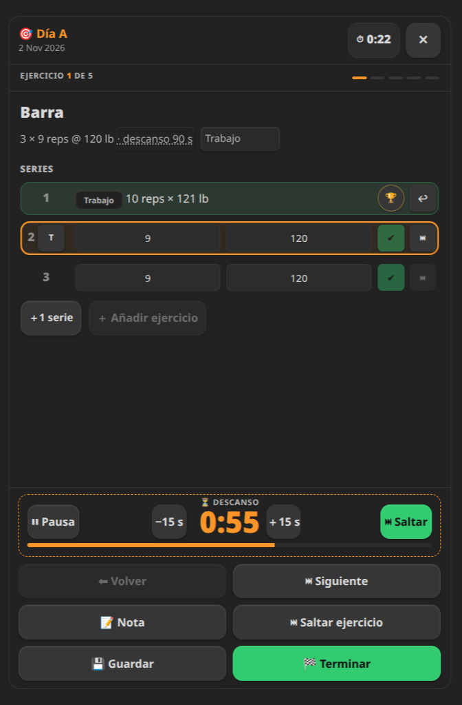
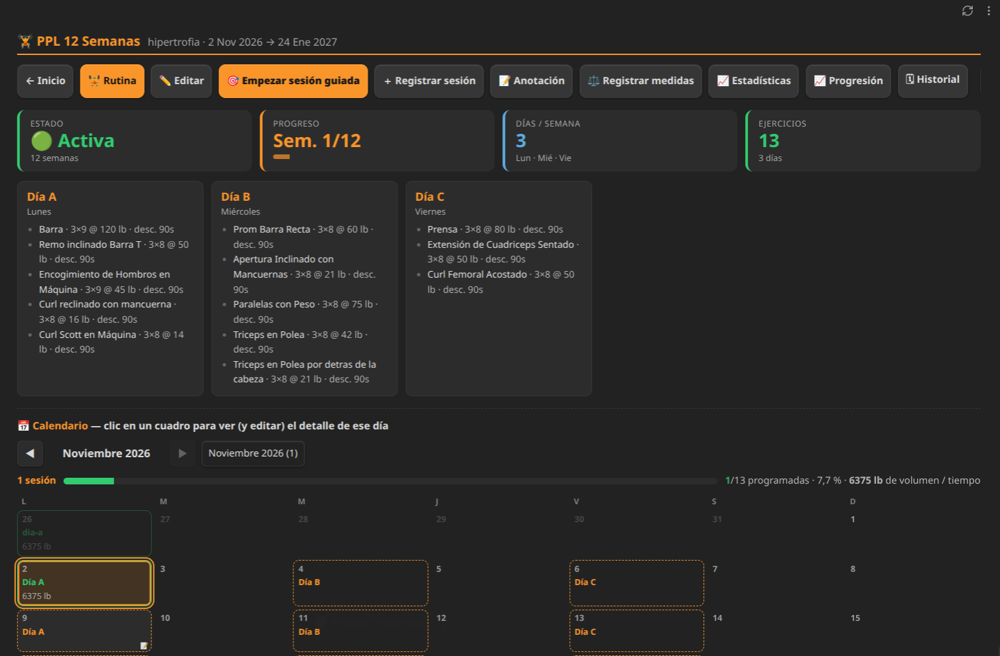

# Gym Stone

Gym Stone es un complemento de Obsidian para planificar rutinas de gimnasio, registrar
entrenamientos y consultar tu progreso. Funciona en escritorio y móvil; los datos se guardan
en tu vault.

## Funciones

- Crea rutinas semanales desde cero o a partir de plantillas.
- Registra sesiones guiadas o manuales, con ejercicios de peso, tiempo e intervalos.
- Organiza ejercicios por grupos musculares y conserva su historial aunque cambies sus nombres.
- Registra peso y talla, y consulta su evolución, el IMC, calendarios y estadísticas.
- Usa temporizadores y cronómetro durante el entrenamiento.

## Instalación

### Desde el directorio de complementos

Si Gym Stone está publicado en el directorio de la comunidad:

1. En Obsidian, ve a **Ajustes → Comunidad de plugins → Explorar**.
2. Busca **Gym Stone**, instálalo y actívalo.

### Instalación manual

1. Descarga `main.js`, `manifest.json` y `styles.css` desde la
   [última versión](https://github.com/adrianoaquesada/gym-stone/releases/latest).
2. Copia los archivos en `<tu-vault>/.obsidian/plugins/gym-stone/`.
3. En Obsidian, activa Gym Stone en **Ajustes → Comunidad de plugins → Plugins sin verificar**.

## Uso

Abre Gym Stone desde el icono de la barra lateral o ejecuta el comando **Abrir la lista de
rutinas**. Crea una rutina, añade ejercicios y registra cada sesión desde la rutina o con la
sesión guiada. Desde Inicio también puedes registrar medidas, explorar el catálogo y consultar
estadísticas.

## Capturas

Sesión guiada:



Rutina semanal y calendario:



En cada ejercicio puedes definir objetivos de peso y repeticiones, duración o ciclos de
trabajo y descanso. Las sesiones guardan los resultados para consultar el historial y la
progresión.

El historial compara las series y el peso planificados con lo realizado. Al terminar una
sesión o iniciar otra, puedes aplicar al objetivo del día actual los valores sugeridos según
el último registro; la plantilla no se modifica.

## Datos

Gym Stone guarda los datos como JSON dentro de notas Markdown en la carpeta raíz configurada
en los ajustes (`gym-stone` por defecto):

| Ruta | Contenido |
| --- | --- |
| `gym-stone/rutinas.gym-stone.md` | Índice de rutinas |
| `gym-stone/datos/rutinas/<id>.gym-stone.md` | Plan, sesiones y anotaciones de cada rutina |
| `gym-stone/datos/medidas.gym-stone.md` | Medidas corporales |
| `gym-stone/datos/ejercicios.gym-stone.md` | Catálogo y grupos musculares |
| `gym-stone/plantillas/<nombre>.md` | Plantillas |

Antes de sobrescribir un archivo de datos, el complemento conserva una copia `.bak`. El peso
se almacena en kilogramos y la talla en centímetros; las unidades elegidas en los ajustes se
usan para mostrar e introducir valores.

## Desarrollo

```bash
npm install
npm run lint
npm run build
```

## Licencia

MIT. Consulta [LICENSE](LICENSE).
